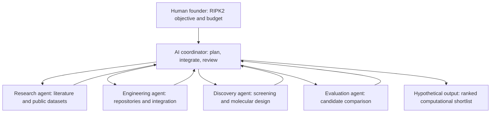

# Can One Person Build an AI Drug-Discovery Company with AI Agents?

**AvatarsBio — Exploratory feasibility assessment**  
**Date:** 14 October 2026  
**Status:** Conceptual study completed; implementation not started  
**Fictional case study:** Pangloss Therapeutics

> [!IMPORTANT]
> **Disclaimer — conceptual game, not validated research.** This is an exploratory desk-based thought experiment about what AI agents *might* be able to assemble using publicly accessible scientific information and existing software. **No agent system was implemented or executed; no computational pipeline was run; no molecules were generated or ranked; and no biological, experimental, or clinical validation was performed.** Agent capabilities, projected costs, and feasibility judgments are informed estimates, **not measured results**. Pangloss Therapeutics is fictional. This report should not be interpreted as evidence of discovered drugs, validated predictions, or a functioning autonomous pharmaceutical operation.

## Executive summary

**Verdict: feasible in principle as a small computational pilot; autonomous end-to-end execution remains unproven.**

Could one researcher direct AI agents to locate, adapt, and integrate public software and scientific datasets, ultimately producing a computational shortlist of candidate drug molecules? Much of the underlying infrastructure already exists: chemical databases, experimental protein structures, molecular docking tools, generative chemistry software, and predictive models.

Progress in AI-assisted software engineering makes autonomous *assembly* of these capabilities increasingly plausible. It does not establish that an AI team can reliably perform the entire workflow, or that its nominated compounds will work in experiments. The goal of this study is to assess the possibility, rather than prove the outcome.

The thought experiment compares two scenarios:

| Scenario | Target | Question for AI agents |
| --- | --- | --- |
| A — reconstruction | EGFR | Can agents independently recover and connect a relatively well-documented computational workflow? |
| B — reconstruction with gaps | RIPK2 | Can agents assemble a workflow from dispersed biological literature, molecular structures, datasets, and software, inferring missing steps where necessary? |

**RIPK2 is the main hypothetical challenge.** EGFR remains a useful reference case, but following an established tutorial would offer a less informative test of agent independence.

## 1. Pangloss Therapeutics: the hypothetical mission

Pangloss Therapeutics is a fictional academic spinout with one human founder. Its goal is to investigate RIPK2, a protein involved in inflammatory signalling, using public scientific resources and AI coding/research agents. The founder has no proprietary drug-design platform and no conventional computational chemistry department.

The initial instruction might be:

> Investigate RIPK2 as a potential drug target. Find appropriate public data and open-source tools, build a computational workflow, and nominate a small set of molecules for follow-up consideration. Reuse existing capabilities wherever possible. Aim to remain within a hypothetical $500 direct-computing budget.

The agents would be expected to determine *how* to approach the objective, not merely execute a complete protocol supplied by the founder.

### Why RIPK2?

RIPK2 offers useful public starting points without requiring us to assume that the scientific problem is completely understood.

- **Structure:** The Protein Data Bank includes the experimentally determined structure of human RIPK2 bound to ponatinib, [PDB 4C8B](https://www.rcsb.org/structure/4c8b). The structure was determined by X-ray diffraction and provides a concrete starting point for molecular modelling. [1, 2]
- **Published inhibitor research:** Investigators have reported RIPK2 inhibitor studies and computational screening strategies, including virtual screening of publicly indexed compounds. [2, 3]
- **Mechanistic complexity:** Research indicates that RIPK2 can act as a signalling scaffold and that some inhibitor effects involve the RIPK2–XIAP interaction, not solely inhibition of catalytic kinase activity. [4]
- **Distributed evidence:** Relevant information is spread across structural databases, medicinal-chemistry literature, biochemical measurements, and general-purpose computational tools.

*RIPK2 kinase-domain structure, PDB 4C8B. Image: [RCSB Protein Data Bank](https://www.rcsb.org/structure/4c8b); original structural data and associated publication are cited in [1–2]. This is a reference structure, not an output generated by Pangloss.*

The last two points make the case particularly interesting. An agent could construct a technically functioning kinase-docking workflow, yet a deeper literature investigation might lead it to propose additional hypotheses or screening objectives. That would test scientific interpretation as well as software integration.

This is **not** a claim that no complete RIPK2 pipeline exists. The scenario was chosen as an exploratory example of integrating fragmented resources, rather than as a confirmed unsolved workflow.

## 2. What computational components already exist?

The following resources represent real, publicly accessible components that an agent team could investigate and potentially reuse. They are **not** a tested, mutually compatible Pangloss software stack.

| Function | Example public resource | Hypothetical agent task |
| --- | --- | --- |
| Biological and chemical evidence | [ChEMBL](https://www.ebi.ac.uk/chembl/), [RCSB PDB](https://www.rcsb.org/), research literature | Recover structures, compounds, assay data, and biological context |
| Molecular processing | [RDKit](https://github.com/rdkit/rdkit) | Prepare compounds, standardize structures, calculate properties |
| Learning and adapting workflows | [TeachOpenCADD](https://github.com/volkamerlab/teachopencadd) | Locate reusable examples and adapt them to another target |
| Structure-based screening | [GNINA](https://github.com/gnina/gnina) | Configure molecular docking and neural-network scoring |
| Generative molecular design | [REINVENT4](https://github.com/MolecularAI/REINVENT4) | Explore and optimize candidate molecular structures |
| ADMET modelling | [OpenADMET Models](https://github.com/OpenADMET/openadmet-models) | Investigate predictive models for relevant compound properties |

These projects provide substantial functionality. For instance, GNINA supports docking and convolutional-neural-network scoring; REINVENT4 offers generative molecular design; and OpenADMET Models contains machine-learning tools for absorption, distribution, metabolism, excretion, and toxicity prediction. [5–9]

The difficult task is selecting methods appropriate to the target, managing dependencies and formats, adapting code, and deciding how to interpret outputs. Tools that exist separately do not automatically form a coherent scientific pipeline.

## 3. Hypothetical AI-agent operation

The figure below represents an **imagined workflow**, not an implemented multi-agent system. It is written in Mermaid, which GitHub renders directly in Markdown.

In this imagined cycle, the agents would investigate suitable methods rather than receiving a complete software specification. If a repository is incompatible with another tool, an engineering agent might write an adapter. If a proposed screening objective fails to reflect published RIPK2 biology, a research agent might recommend revising it. If computational results are inconclusive, the coordinator might request another analysis within the spending limit.

Such behaviours are consistent with the *direction* of contemporary AI software-agent development, but the study provides **no demonstration** that the entire cycle can occur independently or reliably in this scientific domain.

### What would count as success in the game?

We separated two milestones:

1. **Computational workflow feasibility:** Agents assemble and operate a pipeline that accepts scientific inputs and produces computational candidate rankings. This could be assessed technically even if the scientific predictions later prove poor.
2. **Scientific discovery:** Candidate rankings lead to experimentally meaningful activity, selectivity, or other desired properties. This requires separate validation and is outside the present study.

The first milestone is the subject of our feasibility game. The second should not be implied by achieving the first.

## 4. EGFR versus RIPK2

| Assessment dimension | EGFR reference case | RIPK2 exploratory case |
| --- | --- | --- |
| Published examples and learning materials | Extensive | Relevant materials exist but need to be assembled |
| Experimental structural data | Available | Available |
| Public chemical and activity data | Available | Available, with target-specific curation needed |
| Reusing established workflow templates | Relatively straightforward | Requires more adaptation and decision-making |
| Inferring biological screening objectives | Less central to a simple tutorial reproduction | Important because signalling mechanisms may complicate interpretation |
| Value for studying agent independence | Good technical baseline | More informative conceptual challenge |

**Working choice:** treat EGFR as the reference and RIPK2 as the principal conceptual case. A future implementation would need to verify target-specific datasets, available models, and whether similar complete workflows have already been published.

## 5. Illustrative pilot budget

Could the computational work fit inside a **$500 direct-spending ceiling**? Possibly, for a modest proof of concept using existing software and pretrained models. This is a planning hypothesis, **not a quote, benchmark, or validated cost estimate**.

| Budget category | Hypothetical allowance (USD) |
| --- | ---: |
| AI-agent inference for research, coding, and debugging | $120 |
| Compute and rented GPUs | $100 |
| Storage, data processing, and small auxiliary services | $20 |
| Retries, troubleshooting, and additional runs | $100 |
| Unallocated contingency | $160 |
| **Total spending ceiling** | **$500** |

As pricing illustrations checked on **14 October 2026**:

- The [OpenAI API pricing page](https://developers.openai.com/api/docs/pricing) listed GPT-6 Sol **Standard** short-context pricing at **$2 per million input tokens** and **$10 per million output tokens**. Under those rates, a text-only example using 20 million input tokens and 4 million output tokens would cost **$80**, excluding other tool or service charges. Pricing varies by processing tier and can change. [10]
- [Runpod's GPU pricing](https://www.runpod.io/pricing) listed RTX A5000 rental at approximately **$0.27/hour** and RTX 4090 at approximately **$0.89/hour**. For illustration, 40 A5000 GPU-hours would be **$10.80** in rental charges before any applicable storage or ancillary fees. [11]

Neither example predicts the real cost of autonomously integrating and running a complete RIPK2 pipeline. Retries, agent exploration, software incompatibilities, and repeated calculations could increase usage considerably. Human effort, laboratory experiments, licensing of any non-open components, and subsequent development are excluded.

**Cost assessment:** hundreds of dollars could plausibly support a deliberately limited computational pilot. The $500 ceiling has **not** been established as sufficient for a complete autonomous discovery campaign.

## 6. Feasibility scorecard

| Question | Assessment | Basis |
| --- | --- | --- |
| Are relevant public structures, publications, and chemical resources available? | **Yes** | Existing published datasets and studies |
| Does useful computational discovery software exist? | **Yes** | Publicly documented tools and repositories |
| Could AI coding agents assist with integrating these tools? | **Plausible** | General software-engineering capabilities; not tested here |
| Could agents independently assemble and run the entire RIPK2 pipeline? | **Plausible but unproven** | Reasoned extrapolation, not an implementation result |
| Could such a pipeline produce a computational shortlist? | **Plausible** | This is an intended software output, not an observed one |
| Would the shortlisted compounds prove experimentally useful? | **Unknown** | No experiments or scientific validation |

### Conclusion

A **one-person, AI-assisted computational drug-discovery studio** is a credible concept for a future small-scale experiment. Public scientific information and reusable computational components remove many of the barriers that once required a larger specialized team. AI agents may further lower the integration burden.

However, this desk study has not established that autonomous agents can independently operate the entire process. Nor does it support claiming that a complete pharmaceutical company, or experimental drug discovery, has been recreated.

For the original game, that is an encouraging endpoint: there is enough technological substance to justify the possibility, and enough uncertainty to make a future practical test interesting.

Pangloss Therapeutics can remain fictional for now. Its investors have therefore suffered no losses.

## 7. Status and possible future updates

**Closed as a conceptual exploration on 14 October 2026.**

No code was built or run for this study; no agent team was deployed; no candidate molecules were generated; no validation was performed. This repository is intended as a research note, not a product or an active discovery programme.

An occasional future update might check whether agentic coding benchmarks, autonomous scientific workflows, open-source drug-discovery packages, or independent GitHub demonstrations change the feasibility assessment. **No update schedule is committed.**

## References and resources

### RIPK2 biology and structure

1. **RCSB PDB 4C8B.** *Structure of the kinase domain of human RIPK2 in complex with ponatinib.* [PDB entry](https://www.rcsb.org/structure/4c8b) · [PDB DOI](https://doi.org/10.2210/pdb4C8B/pdb).
2. **Canning et al. (2015).** *Inflammatory Signaling by NOD-RIPK2 Is Inhibited by Clinically Relevant Type II Kinase Inhibitors.* *Chemistry & Biology.* [DOI](https://doi.org/10.1016/j.chembiol.2015.07.017).
3. **Cruz et al. (2018).** *Identification of Novel Protein Kinase Receptor Type 2 Inhibitors Using Pharmacophore and Structure-Based Virtual Screening.* *Molecules*, 23(2), 453. [Article](https://doi.org/10.3390/molecules23020453).
4. **Hrdinka et al. (2018).** *Small molecule inhibitors reveal an indispensable scaffolding role of RIPK2 in NOD2 signaling.* *The EMBO Journal.* [Full text](https://pmc.ncbi.nlm.nih.gov/articles/PMC6120666/).

### Computational software

5. [RDKit — open-source cheminformatics](https://github.com/rdkit/rdkit).
6. [TeachOpenCADD — educational and reusable computational drug-design workflows](https://github.com/volkamerlab/teachopencadd).
7. [GNINA — molecular docking with neural-network scoring](https://github.com/gnina/gnina).
8. [REINVENT4 — generative molecular design](https://github.com/MolecularAI/REINVENT4).
9. [OpenADMET Models — machine-learning workflows for ADMET modelling](https://github.com/OpenADMET/openadmet-models).

### Indicative pricing and presentation

10. [OpenAI API pricing](https://developers.openai.com/api/docs/pricing) (accessed 14 October 2026; prices subject to change).
11. [Runpod GPU pricing](https://www.runpod.io/pricing) (accessed 14 October 2026; prices subject to change).
12. [GitHub documentation: Creating diagrams with Mermaid](https://docs.github.com/en/get-started/writing-on-github/working-with-advanced-formatting/creating-diagrams).
13. [RCSB PDB citation and image usage policies](https://www.rcsb.org/pages/policies).

---

## Pangloss's Six-Month Forecast — April 2027

*Fictional scenario written on 14 October 2026.
This is a speculative, deliberately optimistic forecast,
not a scientific prediction or validated result.*

By April 2027, Pangloss Therapeutics expects to announce:

- A fully integrated computational drug-discovery workflow,
  assembled and operated by autonomous AI agents.
- Twelve computationally identified drug candidates,
  including three prioritized for experimental validation.
- Total direct computational R&D expenditure below $500.
- A virtual discovery team operating with one human founder
  and no permanent scientific employees.
- Preliminary investor interest in its AI-driven
  pharmaceutical discovery platform.

**CEO's statement:**

> "We have successfully demonstrated that a pharmaceutical
> discovery operation can be assembled with AI agents,
> public scientific knowledge, and open-source software.
> Experimental validation is planned for the next phase."

**Independent scientific assessment:**

> "Interesting. Have you actually tested anything?"

**Management response:**

> "That is part of our exciting Phase II roadmap."

### Reality Check — April 2027

*To be completed if and when this study is revisited.*

Did autonomous AI agents become substantially more capable
of reconstructing and operating computational drug-discovery
workflows? Which predictions, if any, became plausible?

Until then, Pangloss Therapeutics remains a fictional
company with an exceptionally optimistic management team.

---

*AvatarsBio — [avatarsbio.com](https://avatarsbio.com) · AI-assisted exploratory desk research. Scientific interpretation and publication decisions remain the responsibility of the author.*
